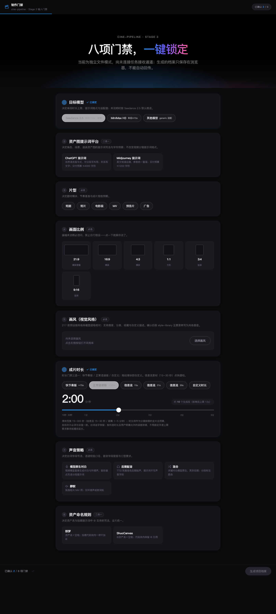
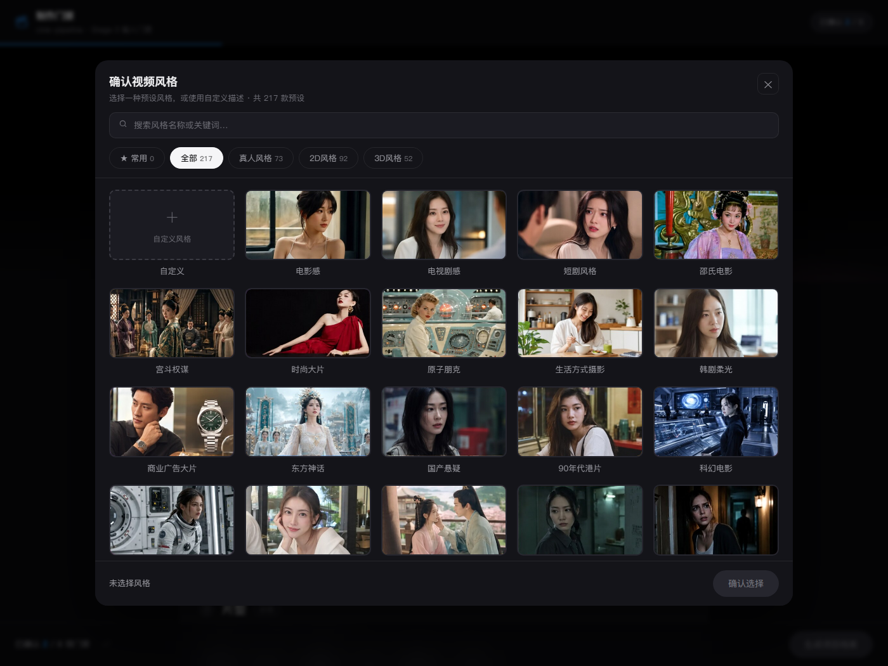

# cine-pipeline · 导演思维全流程 Skill

**给 AI Agent 装上导演的大脑**——从一个点子到可投喂生成模型的分镜提示词，再到后期制作包，一条完整的影视工业流水线。

> A director-mindset pipeline skill for AI agents: **Idea → Screenplay → Storyboard Prompts → Post-Production Pack → Pilot/Batch QC**, built for AI video generation (Seedance 2.5, MiniMax H3, etc.)

---

## 它解决什么问题

让 Agent 写 AI 视频提示词，最常见的翻车是：上来就写镜头，想到哪写到哪，角色每张脸都不一样，台词被"顺手精简"，风格全靠"电影感"三个字随缘。

cine-pipeline 把这件事做成了**有门禁的流水线**：每个阶段必须先过质量门才能往下走，用户的原始意图（台词、时长、风格、画幅）被锁进项目档案层层继承，谁也偷改不了。

## 四阶段流水线 + 生成执行环

```
 一个点子
    │
    ▼
┌─────────┐   ┌─────────┐   ┌─────────────┐   ┌──────────────┐
│ Stage 1 │ → │ Stage 2 │ → │   Stage 3   │ → │   Stage 4    │
│  创意    │   │  剧本    │   │    分镜      │   │  后期制作包   │
│ 方向卡   │   │ 分场剧本  │   │ 门禁锁定→   │   │ 字幕/字体/    │
│ 大纲锁定  │   │ 台词质检  │   │ 资产表→提示词 │   │ 音乐参考     │
└─────────┘   └─────────┘   └─────────────┘   └──────────────┘
                                  │
                    ┌─────────────▼──────────────┐
                    │      生成执行环              │
                    │  试产三镜 → 参数锁定 → 批量QC │
                    └────────────────────────────┘
```

## 核心特色

### 🚪 八项硬门禁，一键锁定

进入分镜阶段前，必须先在自带控制面板上逐项锁定 8 个制作决策——**缺哪项先要哪项，禁止 AI 自行假设**（比如画幅没说明白就必须问）。面板回传即视为全部明示选定，写进项目档案贯穿全程：

| # | 门禁 | 内容 |
|---|------|------|
| 1 | 目标模型 | Seedance 2.5 / MiniMax H3 / 其他模型 |
| 2 | 资产图提示词平台 | ChatGPT / Midjourney 二选一 |
| 3 | 片型 | 短剧 / 短片 / 电影级 / MV / 预告片 / 广告 |
| 4 | 画面比例 | 21:9 / 16:9 / 4:3 / 1:1 / 3:4 / 9:16 |
| 5 | 画风 | 217 款预设风格库 + 自定义 |
| 6 | 成片时长 | 快节奏版 / 正常语速版 / 自定义（15–300s） |
| 7 | 声音策略 | 模型原生对白 / 后期配音 / 混合 / 静默 |
| 8 | 资产命名规则 | 即梦 / ShuoCanvas 二选一 |



### 🎨 217 款画面风格库

真人 / 2D / 3D 全谱系、按家族归纳的 **217 款命名风格**，每款都有预览缩略图，支持搜索、分类筛选、收藏和自定义描述；选定后按"五要素转写法"编译成可投喂的风格基座——把"要电影感"这种模糊要求变成精确的流派、调色、光学、材质指令。



### 🎥 21 位导演视觉语言档案

黑泽明、库布里克、诺兰、王家卫、维伦纽瓦、奉俊昊……21 位导演的可观察镜头语言档案，带**自动匹配路由签名表**——项目气质对上路子，自动调用对应导演的景别习惯、运镜偏好和光影体系。

### 📚 成体系的专业词库

- `camera-lexicon` 景别/机位/运镜/焦段/光圈词典 + 构图雷区 + S0~S4 空间站位编码
- `motion-lexicon` 迪士尼 12 法则 × 牛顿动力学的动作设计原理
- `fight-lexicon` 武学打斗 108 条 + `xuanhuan-combat` 玄幻法术战斗体系
- `facs-lexicon` FACS 微表情四区拆解 + `body-lexicon` 身体语言 60 条——把"他很紧张"转写成可拍的表演
- `vfx-lexicon` 特效 118 条，每条含可直接转写的执行描述
- `prompt-frameworks` 分题材实战框架（H3 六段式 / 商用直出 / 情绪微表情相位法…）

### 🔧 模型适配器 + 资产平台编译

镜头清单按**模型适配器**编译成目标模型可投喂的提示词（Seedance / MiniMax H3 ≤15s 硬约束 / generic 保守假设）；角色·场景·道具资产图提示词再按 **ChatGPT / Midjourney 平台语法与字符预算**分别编译，含准确文字要求的资产自动切换通道。

### ✅ 试产与质检体系

分镜锁定 ≠ 直接开剪：先**三代表镜头试产**（身份/表演/最高风险 VFX）锁定参数，批量生成走 **Dailies 八维评分 + 归因七层**；"很假/很平/运镜很 AI"这类模糊反馈有**审美翻译层**十个维度定位病因，翻车现场按**事故登记簿**一分钟登记、二次复现才回写规则。

### 🧬 自我演进框架

Skill 自带维护纪律：规则/模板/自检三位一体同步、单一事实来源（SSOT）、事故回写三件套、主文件减肥纪律、`validate_suite.py` 结构校验——越用越强，不会越改越乱。

## 适用场景

- 从一个点子/一句话创意开始做片子
- 写剧本、短剧、短片分场剧本，剧本会诊、台词诊断
- 写分镜脚本提示词、优化评审分镜 Prompt
- 单条短视频（vlog/带货/吃播/广告/宠物/恐怖/MV/录屏/风格化动画）的生成提示词
- 景别/运镜/焦段/光圈怎么选
- 分镜锁定后出后期制作包（文字清单/字体音乐参考/字幕 SRT）
- 审片：评估生成素材能不能用，诊断返修

## 目录结构

```
SKILL.md                # 技能主文件：触发路由、创作纪律、门禁与自检
references/             # 知识库（按需加载，省 Token）
├── stage1-idea.md          # 阶段1：创意输出
├── stage2-script.md        # 阶段2：剧本创作
├── stage3-storyboard.md    # 阶段3：分镜脚本（含门禁契约）
├── stage4-postpack.md      # 阶段4：后期制作包
├── directors/              # 21 位导演风格档案
├── *-lexicon.md            # 镜头/动作/表情/打斗/玄幻/特效词库
├── model-adapters/         # 生成模型适配器
├── genre-modules.md        # 类型片模块（含60-100集连载短剧引擎）
└── rights-and-safety.md    # 权利门禁：改编/肖像/音色授权
scripts/                # 校验与门禁脚本（Python / Node）
tools/                  # 工具（含门禁控制面板 HTML，可直接打开体验）
```

## 使用方式

把本目录复制到 Agent 的 skills 目录（如 `.codex/skills/`、`.devin/skills/`、`.claude/skills/`）即可被识别加载；`tools/门禁控制面板.html` 是零依赖单文件，浏览器直接打开就能看到上面的八项门禁面板和风格库。

## License

MIT
